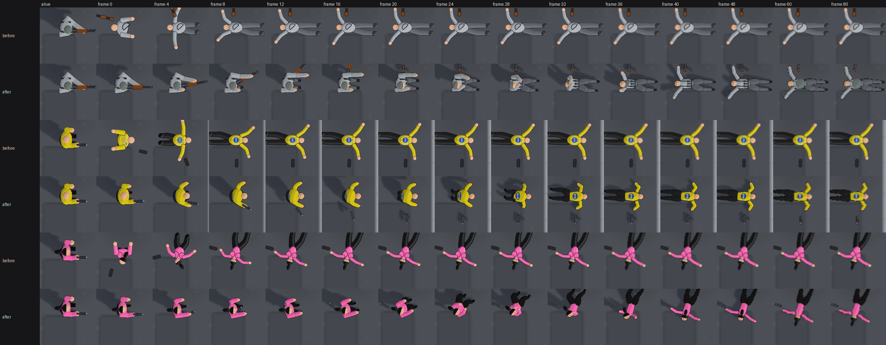
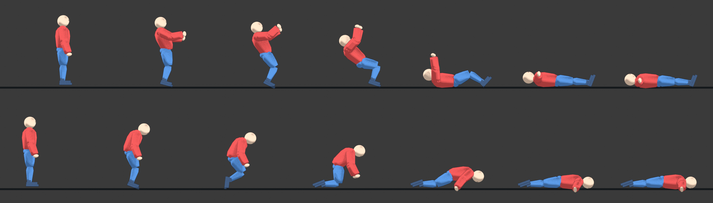
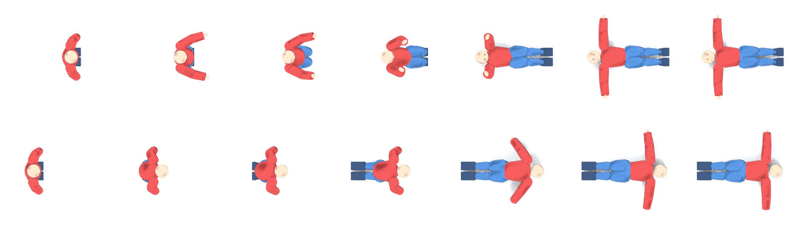
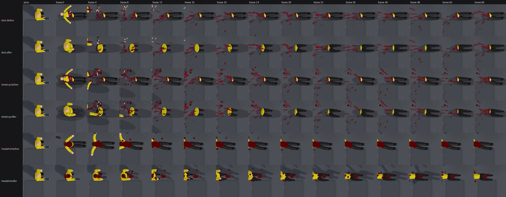

# Death falls

A body used to reach the floor seven frames (about a ninth of a second) after
the killing shot, and a figure drawn by the 3D model was swapped on that same
frame for the flat 2D corpse painter, already partly lying down. Deaths now
take a little under a second, timed by two falls authored in Blender, and a
model-drawn figure stays the model from the shot to the stamp in the ground:
it goes down from the pose it was last drawn in, through every death type, and
lies in the same pose, proportions and blood the 2D corpse always had.

Before (top of each pair) and after, every 4 frames at 60 Hz, real `draw()`
frames in Stick City. The last column is the same corpse in both:



## The falls in Blender

`assets/player/player.blend` carries two actions on `PlayerRig`, keyed at the
game's 60 Hz simulation rate:

| action | what happens | floor contact | at rest |
|---|---|---|---|
| `Death_Fall_Backward` | shot from the front: recoil, knees unlock, sits back with the arms flung up, lands on the back, the head last | frame 40 | frame 54 |
| `Death_Fall_Forward` | shot from behind or running: head drops, knees buckle, kneels, topples onto the chest, legs slide out | frame 37 | frame 54 |

Each key is posed from a few body controls (pelvis position and pitch, spine,
chest, neck, arm raise, sweep and elbow) with the legs solved by two-bone IK to
authored ankle targets, and Blender's Bezier curves make the in-betweens. The
actions are ordinary F-curves and can be edited in Blender.




```sh
blender --background assets/player/player.blend --python tools/blender-falls.py -- --save
python3 tools/build-player3d.py
```

`tools/blender-falls.py` authors the actions (`--save` writes them into the
`.blend`), samples them every frame into `assets/player/player-falls.json`, and
renders the two contact sheets above (`--skip-renders` to leave those out).
`build-player3d.py` embeds the JSON in `game.js` as `PLAYER3D_FALLS`.

## What the game takes from Blender: timing

A corpse ends in its own rest pose (its arm and leg archetypes, its limb
springs, a hand held over the wound), so the Blender end pose is never copied.
What is exported is each part's progress along its own path, from standing (0)
to lying (1), and it may overshoot and come back:

| channel | meaning |
|---|---|
| `projected` | the pelvis-to-head distance seen from above: the 2D painters' progress (`fP`) |
| `pelvisDrop`, `pelvisTravel` | how far the pelvis has come down, and along the fall |
| `torso`, `head` | the spine and the neck rotating toward the floor (the head lags, then whips) |
| `thigh*`, `shin*` | each leg bone's turn toward its rest (a buckle runs it backward first) |
| `armSweep*`, `armRaise*`, `foreSweep*`, `foreRaise*` | each arm bone's swing out from hanging and raise toward the chest's front, in the chest's frame, as radians away from a straight interpolation (the reach and the flail) |

## Every humanoid death: the clock

`figureFallTiming()` gives a death fall its action: `FORWARD` when the body
lands face down, `BACKWARD` otherwise. `figureFallProgress()` reads
`projected` at the fall's age, so the 2D painters (every humanoid the native
painter draws, citizens and townsfolk included) collapse on the same curve.
Contact is the action's contact frame, the fall ends at its settle frame, and
the limb springs run as long. Weapon force still shoves the body further; it
does not change how long the fall takes. A punch stun keeps its own buckle,
and a death resumed from a stun or a leg injury starts at the age where the
curve reaches the progress it already had (`figureFallAgeFor()`).

## One system: the model from the shot to the stamp

A corpse whose figure the model drew on the frame before it died keeps
`c.model3D` (the captured living pose) and is drawn by the model for its whole
life, then pressed into the ground with one model draw (`stampCorpse()` through
`drawPlayer3DCorpse()`). There is no hand-over to the native painter on the
floor. The player has always worked this way; enemies (`ENEMY3D_HUMAN_TYPES`)
now do too. A figure the native painter was drawing at death (stunned,
leg-injured, mounted, boxing, a citizen) keeps the native corpse, and without
WebGL every corpse falls back to it.

Every death type starts from the living pose:

| death | how it goes down on the model |
|---|---|
| ordinary, headshot, face down (0, 1, 6, 7, 8, 9) | the Blender fall below |
| shotgun separation headshot (4) and 2 | the same fall: a model-drawn body has no frozen 2D frames to keep (`legacyOverkillFall()` still holds for native bodies) |
| shotgun slice and breakup (gun overkill) | each thrown piece carries the living pose in its own drawing frame (`player3DFallLocalize()`) and lies down on the Blender clock while it flies (`player3DPieceFall()`); until it lands the torso is split along the spine at the cut (`player3DPieceShorten()`), because a flat cut cannot divide a standing body; the flat cut takes over once it lies |
| explosive deaths (18, 19, 20) | the same per-piece fall |
| sword decapitation and diagonal cut | the halves fall on the model; the sword's cut still divides them |
| slump against a wall | the slump's own seat, relax and tip, blended from the living pose over its first 18 frames (`player3DSeatBlend()`) |

The shotgun's close-range deaths, before (the model swapped for 2D pieces
already lying) and after (each piece leaves from the standing pose):



The rare dismemberments (lightning gibs, the melee and shockwave splits) are
drawn on the model too, as pieces from their first frame, as the native
painter drew them.

What the native corpse painter drew, the model corpse carries:

- **Proportions.** The sleeve, forearm and palm are the 2D rig's
  (`projectFallRig()` at the corpse's progress, times `RAG_SCALE`): an upper
  arm of 5.8 rather than the living mesh's 8.4 (4.4 on the narrower build), a
  forearm of 5.2 rather than 6.7, a palm of 6.1 rather than 6.5. The fall thins
  the living widths into them.
- **The NM-0 regulars' insignia.** The circular NMO patch on the back and the
  crest on the right chest are a Blender mesh (`nm0_insignia`) laid on the
  torso loft, at the 2D painter's own sizes and positions, worn by
  `NORMAL`, `NM0_ROOKIE` and `NM0_ROOKIE_F`, living and dead.
- **Hair** on bare heads, through the fall and lying (`player3DCorpseHead()`).
- **A closed face** once a body on its back is most of the way down: the
  model's open eyes and brows take the skin colour and the native closed eyes
  and nose are painted over (`player3DCorpseCloseEyes()`).
- **A fallen hat** lands where the native painter laid it, in the colour it
  was worn in; the dropped weapon falls from the hand to its native spot.
- Wounds, the collar blood, the face-down pool and gibs as before.

A body on its back now faces the sky: the 3D corpse frame had resolved a lying
torso toward the floor, showing the back of the head with the jetpack on the
chest.

## A model-drawn figure: the fall on the model

`player3DFallCapture()` copies, at death, the pose the model drew on the
previous frame (`_player3DLiveSnapshots`), for the player and for every enemy
`enemy3DLivingEligible()` lets the model draw. A figure the native painter was
drawing (stunned, leg-injured, mounted, boxing, a citizen) keeps the native
fall, and so do wall slumps, sword and blast deaths, particle-beam deaths and
bodies coming apart.

`player3DFallSkeleton()` blends that pose into the corpse rig at progress 1
(`player3DCorpseSkeleton()`, the joints the native painter and the stamp have
always drawn):

- the pelvis drops and travels by its channels;
- the torso and head turn as quaternions, slerped by `torso` and `head`, which
  also carry the turn from the living facing to the corpse's yaw;
- the legs turn bone by bone in the plane between where they were and where
  they rest;
- the arms interpolate their sweep and raise in the chest's frame and add
  Blender's departure, so whatever archetype the corpse drew, the arms reach
  and flail on the way;
- limbs pair by side: the corpse rig numbers them in its own lying frame, so on
  its back its arm 0 is the living figure's right arm;
- nothing goes below the height it rests at, or below where it started.

At frame 0 the blend is the living pose; at the settle frame it is exactly
the corpse rig. The falling body keeps the living figure's pinhole camera and,
in a cel level, casts its own shadow, which shortens to nothing as it lands.
Its weapon goes down from the hand to where the corpse's dropped weapon lies,
a hat that comes off rolls off the head to where the corpse lays it, bare
heads keep their hair, and wounds ride the falling chest and head
(`fatalWoundPoint()`).

Once it has settled the body is that 3D corpse, the same pose, so there is
nothing to swap.

## Cost

A falling model costs about what the same figure cost alive a moment earlier,
for under a second; a body lying on the floor is one model draw until it is
stamped, then nothing. A volley that drops a dozen bodies at once would stamp
them all on one frame, so model stamps take turns, `MODEL_STAMPS_PER_FRAME`
(2) a frame, and a body waiting its turn is still the model.

Twelve model-drawn enemies shot on the same frame, real `draw()` in headless
Chromium on SwiftShader (the GPU emulated on the CPU, so only the comparison
means anything), median frame time:

| | alive | falling | settling (the stamps) | lying |
|---|---|---|---|---|
| before (2D corpses) | 9.5 / 11.3 ms | 6.1 / 5.9 ms | 3.0 / 3.0 ms, worst 5.5 | 2.9 / 3.1 ms |
| after (model corpses) | 9.5 / 9.3 ms | 9.8 / 9.0 ms | 4.6 / 5.6 ms, worst 13–24 | 3.5 / 3.5 ms |

The worst settling frame is the first stamp creating a ground-blood canvas
while a dozen bodies are still drawn; it has not been measured on a phone,
where the model draws run on the GPU.

## Checks

```sh
node tools/check-death-fall.js            # timing, start/end continuity, floor, widths, pieces, slump, insignia, stamp budget
node tools/check-falls-and-footwork.js    # the clock (asserts the Blender curve, not the old 0.15 a frame)
node tools/check-corpse.js                # settle and freeze
node tools/check-humanoid-corpse-standard.js
node tools/check-leg-injury-corpse.js     # resumed falls
node tools/check-fatal-wounds.js
node tools/check-player3d-corpses.js
node tools/check-player3d-corpse-browser.cjs
```
