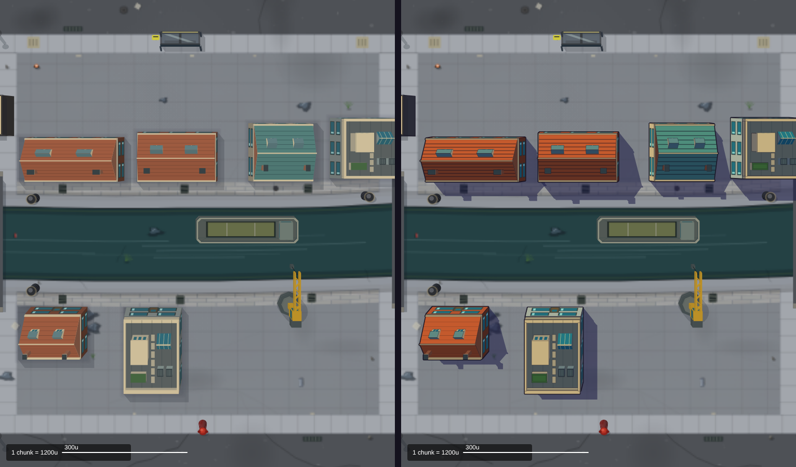

# Level 1 comic depth pass

Stick City's streets now read as inked, cel-shaded solids rather than tinted
roof decals. Geometry, footprints, collisions, placement, destruction keys and
the embedded Blender roof kit are unchanged: this pass changes how the faces
that already existed are toned, outlined and shadowed.



Morning light across a courtyard district:
[previews/level1-cel-depth-morning.png](previews/level1-cel-depth-morning.png)

## What changed

- **Cel tones.** `CityBuildings3D.draw()` snaps each face's diffuse term to
  shade / mid / lit (`celBand`, `CEL_WALL`, `CEL_ROOF`, `CEL_TRIM`). Shade leans
  cool and lit leans warm. `drawMassSides()` applies the same three bands to
  every other mass in Level 1.
- **Ink.** Each roof-kit building gets one batched silhouette stroke painted
  before its fills (the fills cover the inner half of the line), ink on wall
  corners and eaves, and a thin line on large roof planes (`f.ink`, `f.hull`).
  `drawMassSides()` strokes the wall quads it already draws.
- **Roof-shaped shadows.** `CityBuildings3D.drawShadow()` drops every roof and
  wall vertex to the ground along the sun at its own height, so ridges throw
  gables and chimneys throw notches. The path is in world space, cached per
  building, and rebuilt only when the sun moves. Other block buildings use a
  hulled shadow in the same tone and length (`CEL_SHADOW_REACH`).
- **One sun caster.** In Level 1 the 2D pass owns sun shadows even when the
  WebGL light rig is running (`celCityScene()`, `uSunCast`). The rig skips its
  shadow ray march there and keeps relief shading, specular and lamp shadows.
- **Figure shadows.** `celFigureShadow()` replaces the contact oval under
  humanoids with a cast shadow built from the pose
  ([preview](previews/level1-figure-shadows.png)):
  - `celFigureSkeleton()` is one set of capsules blended between standing,
    crouched and lying, so crouch, prone, cover and knockdown morph the same
    shadow instead of swapping to a different one. The stance and stun draw
    paths call it too.
  - Each part is dropped along the sun at its own height. A carried long gun
    lies across the chest and turns to the aim with the presentation spring.
  - Edges are soft: the shape is filled in layers whose radii grow with the
    part's height, so boots stay firm and the head dissolves. The player gets
    four layers, other figures two.
  - Where the shadow reaches a visible wall face it folds up the face along
    the building's own lean (`celFigureWalls`, `celFigureWallFlush`), clipped
    to that face and painted after the building is drawn.
  - Cost in software-rasterised Chromium: about 4.3 ms for sixty non-player
    figures, against 0.5 ms for sixty ovals. Not measured on a phone.
- **Colours.** The city's ground palette (`BIOMES[1].pal`) is unchanged. Roof-kit
  material colours are saturated once per building plan (`vivid`).

All of it is gated on `currentLevel === 1 && currentBiome === 1`; other levels
draw exactly as before.

## Cost

Measured in headless Chromium with software rasterisation, 900x1400, eleven
roof-kit buildings on a panning camera: the shadow plus depth-sorted mass
passes went from about 10.2 ms to about 11.5 ms median. This is one stage on
one host, not whole-game FPS, and it has not been measured on a phone. The
light rig's sun march no longer runs in Level 1, which is not included in that
figure.

## Checks

```sh
node tools/check-city3d.js
node tools/check-city3d-props.js
node tools/check-city3d-browser.cjs
node tools/check-depth.js
node tools/check-render.js
node tools/check-lighting.js
node tools/check-frame.js
node tools/visual-world.js 1 600 7800 0.8 hour=15
```

`check-city3d-browser.cjs` allows the ink band outside the height mask (its
silhouette tolerance went from 0.5% to 4% of the building's pixels).
`check-depth.js` (136/143), `check-civic-terrace.js` and
`check-city-districts.js` fail identically before and after this change.
Blender was not available in this session, so the roof kit was not re-exported;
`CITY3D_ASSET` is untouched.
