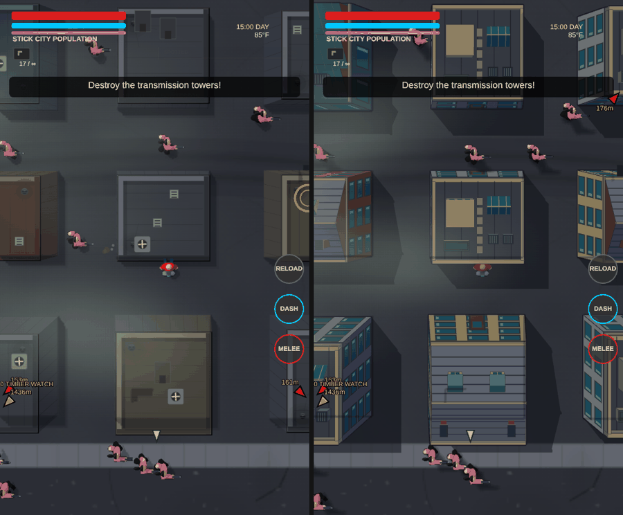
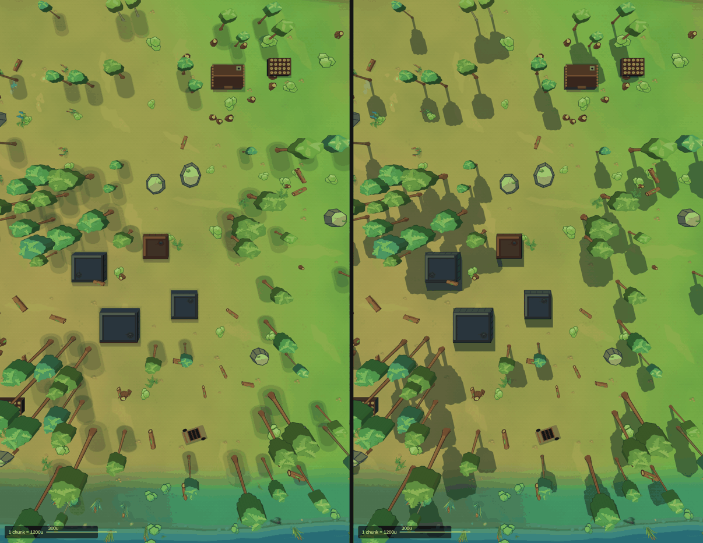
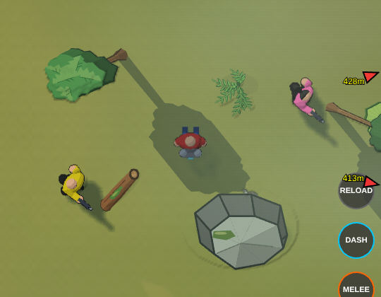

# Level 2 comic depth pass

The Undercity is now drawn the way Stick City is: inked cel solids, shadows
thrown in the shape of whatever cast them, figures casting their own posed
shadow and darkening where something shades them, walls under the street and
roofs over it. It is the second level on that system, and from here on that is
the system levels are drawn with. See [the Level 1 pass](level1-cel-depth.md)
for how each piece works; this page covers what generalising it took and what
is particular to the Undercity.

Streets inside the curtain wall, before and after, in the real `draw()` with
the WebGL rig running:



The forest outside it, before and after (`tools/visual-world.js 2 -5400 -3000 0.6 hour=13`):



A figure standing in a fir's shadow is shaded; its own shadow is kept only
where it falls on sunlit ground:



## One table, not a level number

`celCityScene()` was `currentLevel === 1 && currentBiome === 1`. It is replaced
by `CEL_LEVELS`, and every part of the system reads that table:

| field | meaning | Stick City | Undercity |
|---|---|---|---|
| `biome` | the biome the level is played in | 1 | 2 |
| `city(b)` | which block buildings take the roof kit and storeys | all of them | the walled streets (see below) |
| `storeys` | r01 split between two, three and four storeys | 0.42 / 0.78 | 0.30 / 0.68 |
| `roofs` | roof kit palette | `STICK_CITY` | `UNDERCITY` |
| `lit` | one window in this many lit after dark | 4 | 11 |
| `shade(x, y)` | the hue of a shadow at that point | sky slate | teal in the forest, sky slate in the streets |

- `celScene()` (needs a live biome) gates the shadows, the sorted pass's
  wall/roof split, the figure casters and the rig's `uSunCast`.
- `celLevel()` and `celCityBlock(b)` gate the art: `CityBuildings3D.profile()`
  and the storeys in `buildingRise()`.
- A new level joins by adding an entry. Levels without one draw exactly as
  before; `tools/check-cel-levels.js` asserts both.

## Buildings

- **The roof kit, in the Undercity's materials.** The authored blocks inside
  the curtain wall now go through `CityBuildings3D`: Blender roofs, cel bands,
  one batched ink silhouette, roof-shaped shadows and the wall/roof split. The
  geometry is Stick City's kit unchanged; `UNDERCITY_PALETTE` paints it in soot
  slate rather than terracotta, tar for membrane, verdigris copper, soot brick,
  grimed trim and dim glass. The four wall colours are the sector's own (wet
  concrete, soot brick, rendered block, corrugated steel), lifted enough for
  the cel bands to read. Average face luminance is about three quarters of Stick City's,
  so it stays the darker city.
- **Storeys.** The same two, three and four storey heights as Stick City,
  mixed a little taller (the sector is tenements). The tallest wall measured
  across the authored map leans 84.8 units, inside `BUILDING_GAP_MIN` (90).
- **Blackout.** One window in eleven is lit after dark instead of one in four.
- **The forest ruins stay ruins.** The streamer scatters roofless shells, a
  burnt-out hamlet and lone ruins through the woodland, all flagged
  `isBlockBuilding`. `CEL_LEVELS[2].city()` excludes chunk solids outside
  `CITY_DENSE` ground and anything `burnt`, so these keep their own art and
  exactly their old height (asserted), while still taking cel walls, ink and a
  cel shadow like every other mass in the level.
- The canal-facing doors are Stick City's; the Undercity's fronts use the
  hashed side.

## Trees

The rig used to march every tree's sun shadow in the forest; the Canvas
fallback was a soft capsule. With the march off in a cel level, the crowns now
cast in the 2D pass (`celTreeShadow()`):

- The bole is dropped from the root to where the foliage begins, and the
  crown's own contour is swept from `FOREST_CROWN_LOW` to the height of its
  highest bough. The shadow is the tree's side profile: a trunk running out to
  a ragged crown stretched by the depth of the foliage.
- The sweep is one polygon (the contour split at its two tangents to the
  sweep), not both copies plus a quad per edge. The boughs are not cast one by
  one: each is a 20-point polygon lying almost wholly inside the crown's
  shadow, and five per tree were the entire cost of the union fill, while at
  play zoom the result was indistinguishable.
- Paths are in world space, cached per tree and rebuilt only when the sun moves
  by 1/128 of a unit per unit of height.
- Every tree in view is added to one path and filled once, so overlapping
  crowns do not double-darken. Shadows lying wholly off screen are not added.
- Trees throw at `CEL_TREE_REACH` (1.35, the rig's own slope), not the
  buildings' 2.0, because a tree's rise is its real height (102-136) where a
  building's is held low. A crown's shade is `CEL_TREE_SHADE` (0.84) of a
  wall's.
- Generic `TREE` / `PINE` / `SNAG` decor (Stick City's parks, for one) uses the
  same path at its own scale. The soft `forestContactShadow` capsule and the
  generic painted oval stand down wherever a crown has been cast.

## Figures under trees

Every crown cast this frame is recorded (`_celTrees`) as an ellipse slightly
inside its painted contour plus the two heights its foliage spans. A ground
point is shaded when its ray back toward the sun passes inside the ellipse
between those heights: a segment against an ellipse.

- `celTreeShadeAt()` answers that on the CPU, for the capsule-skeleton
  fallback and its whole-shadow fade.
- `celFigureShadeTrees()` hands the six nearest crowns to the Player3D shader
  (`uShadeDisc`, `uShadeSpan`, `uShadeLeaf`) alongside the four building boxes.
  The fragment test is the same one, done where the fragment lands on the
  ground, so the shade on a figure runs on from the shade on the floor and the
  figure's own shadow is dropped where it would double up.
- `check-cel-levels.js` replicates the shader's arithmetic against the
  descriptor and asserts it matches the CPU test at 529 ground points.

## Colour

`celShadowRGB(x, y)` takes the caster's position. A level may give a place its
own hue: the Undercity's forest keeps the teal (`14, 35, 36`) its floor was
always shaded in, because a slate wash over moss turns a lit wood grey; its
streets keep the sky slate every other shadow uses. Building, tree and both
figure casters pass their position.

## Fixes found on the way

- **Stale p5 fill cache.** Every cel shadow wrote `drawingContext.fillStyle`
  directly, behind p5's back, and left it there. p5 skips setting a fill it
  believes is already current, so the next `fill()` of the colour p5 had cached
  could draw in shadow colour. Each direct write now puts the previous style
  back (`_cfsPaint`, the tree union, the hull shadows, both roof-kit
  `drawShadow`s). This came in with the Level 1 pass.
- **Lamp haze budget.** `drawNightLights()` asked `glRigOwnsSunShadows()` to
  mean "the rig is running", which has been false in Stick City since its pass
  even with the rig on. It asks `glRigActive()` now.

## Cost

Real `draw()` frames in headless Chromium with SwiftShader (software
rendering), 540x1000, WebGL rig running, a dense forest patch at
(-5400, -3000) at 13:00 with the sun moving, median of 60 frames:

| build | median frame |
|---|---|
| before this change | 22.6 / 24.1 ms |
| this change with tree shadows switched off | 21.7 / 24.4 ms |
| first tree shadows (Minkowski crown sweep, five bough polygons per tree) | 31.6 / 34.3 / 46.9 ms |
| crown as one polygon, boughs still separate, off-screen trees culled | 29.7 ms |
| boughs at half resolution | 28.4 ms |
| **final: crown only, swept to the highest bough** | **20.8 / 25.8 ms** |

Building and caching the paths measured 0.47 ms a frame for about 93 trees;
the cost was all in filling the union, and nearly all of that was the bough
polygons. This is one host and one renderer, not whole-game FPS, and it has not
been measured on a phone. The rig's sun march no longer runs in Level 2,
which a GPU pays for and this measurement mostly does not show.

## Checks

```sh
node tools/check-cel-levels.js       # new: gate, Undercity roofs/storeys, hue, tree crowns, figure shade
node tools/check-depth.js            # the wall/roof schedule now covers Level 2; Level 4 keeps one piece
node tools/check-lighting.js
node tools/check-city3d.js
node tools/check-render.js
node tools/check-forest-sunlight.js
node tools/check-forest-depth.js
node tools/check-forest-canopy-occlusion.js
node tools/check-forest-tall-trees.js
node tools/check-forest-render.js
node tools/check-forest-floor-art.js
node tools/check-figure-volume.js
node tools/check-saveload.js
node tools/check-population.js
node tools/visual-world.js 2 600 600 0.8 legacy actors hour=15
node tools/visual-world.js 2 -5400 -3000 0.6 hour=13
```

`check-depth.js` fails the same seven assertions it fails before this change
(143/150). `check-forest-art-parity.js` against the previous `game.js` differs
only for the six crown species on the live target, which is the intended
change of shadow; floor props and bakes are pixel-identical.
`check-forest-floor-art.js` gained one warm-up paint: in a cel level the
figure's shadow comes from the capsule skeleton on the very first draw, before
the Blender model is ready, and from the model after.
