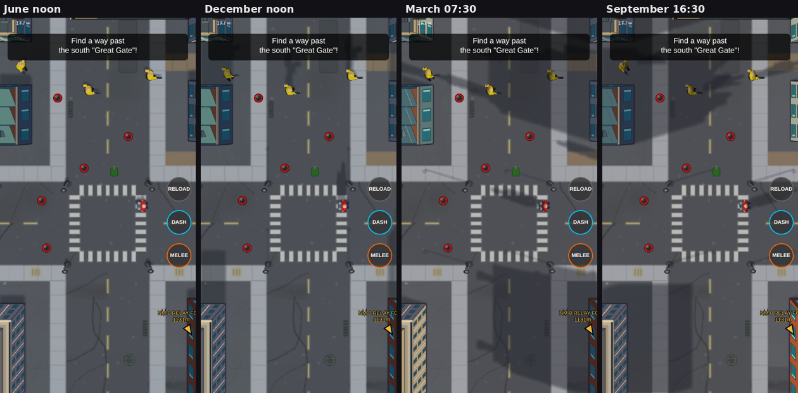
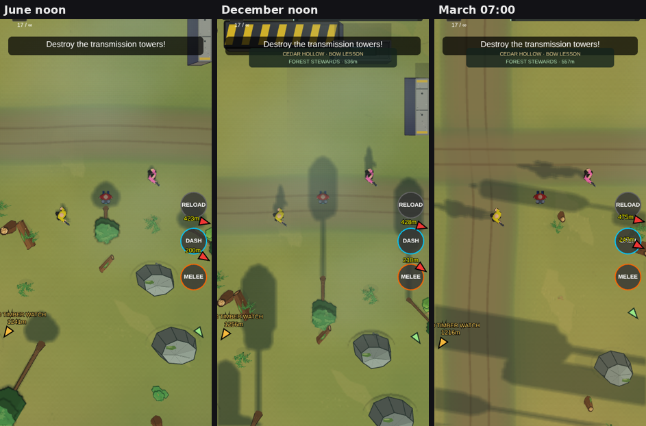
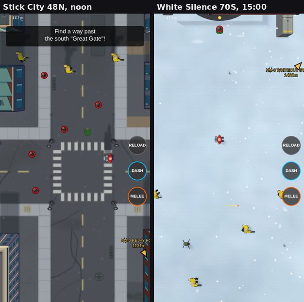
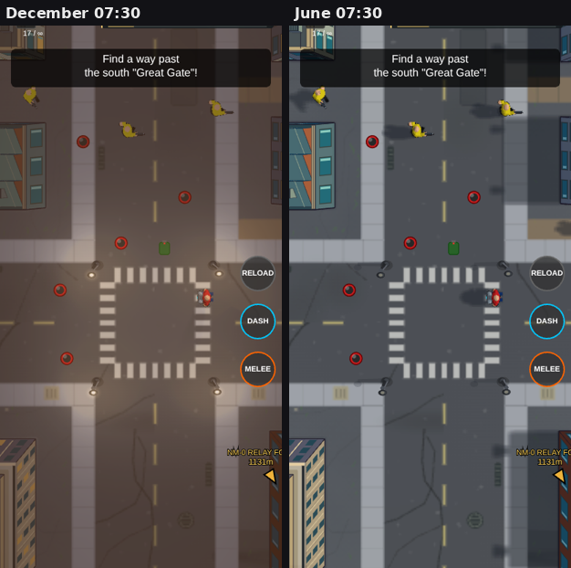

# Solar shadows: seasons and latitude

The world map runs down the globe: Stick City on the northern US border, the
Undercity in the temperate middle, Dry Gulch on the Tropic of Cancer, the Green
Line across the equator and the White Silence in Antarctica. The sun now
follows that. Where it stands, and so which way every shadow in Sectors 1-5
falls and how far it throws, depends on the time of day, the time of year and
the player's latitude.

Stick City (48°N) through the year and the day, real `draw()` frames at a
phone's width. The noon shadow points north (up the screen) and runs about six
times longer in December than in June; mornings throw west, afternoons east,
and the buildings off the edge of the screen still lay their shadows across
the street:



The Undercity's forest (38°N): a short midsummer crown shadow, a long winter
one, and an equinox sunrise where every crown shadow on screen comes from a
tree off the right-hand (east) edge:



Crossing the equator: Stick City's noon shadows fall north, the White
Silence's fall south (here 15:00 in December, the southern summer, when the
Antarctic sun is to the north-west):



## The season

| | |
|---|---|
| `seasonProgress` | 0 at the March equinox, 0.25 the June solstice, 0.5 September, 0.75 December |
| `SEASON_YEAR_DAYS` | 28 in-game days to a year, seven a season (one in-game day is 48 real minutes) |
| `seedWorldClock()` | picks a time of year once per run, as it picks the hour |
| save | `seasonProgress` and `seasonLocked` ride the save; an older save keeps the run's season |

Console and test controls (all on `window`):

```js
setSeason('WINTER')   // the northern season at its solstice or equinox
setSeason(0.25)       // a raw seasonProgress
setSeasonDay(172)     // a calendar day, 0 = 1 January
advanceSeason(3)      // three in-game days on (negative goes back)
lockSeason(true)      // hold the season while the clock keeps running
seasonName()          // named for the player's hemisphere
SUN                   // lat, decl, hourAngle, elev, azimuth, dirX/dirY, length, fade, up
```

The climate readout shows the season and latitude under the temperature, for
example `WINTER 48°N`. The alien worlds show neither.

## Latitude

`SOLAR_LATITUDE` gives each sector a north and a south edge, blended by the
player's world y over `SOLAR_LAT_SPAN` (thirty kilometres either way, so walking
moves the sun by a fraction of a degree):

| sector | north edge | at y = 0 | south edge |
|---|---|---|---|
| 1 Stick City | 49°N | 48°N | 47°N |
| 2 The Undercity | 40°N | 38°N | 36°N |
| 3 Dry Gulch | 24°N | 22°N | 20°N |
| 4 The Green Line | 0° | 5°S | 10°S |
| 5 The White Silence | 65°S | 70°S | 75°S |
| 6, 7 alien worlds | no latitude: the default sun, unchanged | | |

The closed interiors (Levels 0, 8, 9) also keep the default sun.

## The sun

Computed once whenever its inputs change (`_skyTerms()`: the clock, the biome,
rain, the latitude quantised to 0.01°, the season), into the plain numbers on
`SUN`. Nothing is computed or allocated per caster.

```
declination  d = 23.44° x sin(2 pi x seasonProgress)
hour angle   H = (hour - 12) / 24 x 2 pi               (-180° at midnight, 0 at noon)
elevation    sin(el) = sin(lat) sin(d) + cos(lat) cos(d) cos(H)
sun east     E = -cos(d) sin(H)
sun north    N =  cos(lat) sin(d) - sin(lat) cos(d) cos(H)
shadow       (LIGHT_DX, LIGHT_DY) = (-E, N) / |(E, N)|  (screen: east +x, north -y)
length       shadowLengthScale() = 1 / tan(el), clamped to 0.25 .. 4.5
fade         0 at the horizon -> 1 at el = 0.05 rad, smoothstep; shadowDensity() takes it
```

What that gives, at noon:

| | equinox | June | December |
|---|---|---|---|
| Stick City | 42°, shadow north, x1.11 | 65°, north, x0.46 | 19°, north, x2.98 |
| Dry Gulch | 68°, north, x0.40 | 89°, **south**, x0.25 | 45°, north, x1.02 |
| Green Line | 85°, south, x0.25 | 62°, south, x0.54 | 72°, **north**, x0.33 |
| White Silence | 20°, south, x2.75 | polar night | 43°, south, x1.06; midnight sun |

Mornings throw west and evenings east everywhere; at an equinox the sun rises
at 06:00 and sets at 18:00 at every latitude.

### Day length

Everything the sun drives follows it, not only the shadows: `daylight()` and
the night wash (and so the lamps, the lit windows and the ambient level),
`goldenHour()`, the key light's colour (`sunHeight()`), the player's flashlight
(on while the sun is below the horizon) and the air temperature.

Stick City at 07:30: twilight in December, with the lamps still on and the
sun twenty-five minutes from rising; full morning in June, three and a half hours after
sunrise:



| | sunrise | sunset |
|---|---|---|
| Stick City, June | 04:05 | 19:55 |
| Stick City, December | 07:55 | 16:05 |
| any sector, equinox | 06:00 | 18:00 |
| Green Line | within about 20 minutes of 06:00 / 18:00 all year | |
| White Silence, June | polar night: a twilight noon | |
| White Silence, December | midnight sun (3.4° up at midnight) | |

The hour on the clock is solar time, noon at 12:00, so the White Silence's
December midnight is dim and gold rather than dark.

**Twilight.** The sky keeps light while the sun is less than 8° below the
horizon (`TWILIGHT_EL`), from `TWILIGHT_LIGHT` (0.42 of daylight) at the
horizon down to night. It is a floor under the daylight curve and a function
of the elevation alone, so it runs continuously through the year: every dusk
lingers a little before night falls, and the White Silence's polar winter --
the noon sun 3.4° down at 70°S -- is a dim blue twilight (about 0.25) around
noon rather than a night. No sun means no shadows, and the flashlight stays
on. The climate readout says TWILIGHT while it lasts.

Calls made here:

- **What counts as a full noon.** Brightness and colour read the elevation
  against `SUN_HIGH_SIN` (55°), not the zenith. Every palette was authored
  against a noon of 1; measured against the zenith, a temperate equinox noon
  (42° at Stick City) would come out late-afternoon gold. A December noon at
  Stick City (19°) is still a low, warm winter sun. `SUN.up` stays the true
  sin(elevation) for anything that needs a direction.
- **The flashlight follows the sun**, which is the old 18:00 to 06:00 at an
  equinox and keeps the clock on the alien worlds.
- **The polar night is a twilight.** Around the June solstice the White
  Silence gets a few in-game days without a sunrise (roughly four real hours).
  Its noons are a dim twilight rather than full night; the flashlight is on.
- **A run opens in its own daylight.** `seedWorldClock()` picks the season,
  then the hour against that day's sunrise and sunset where the run starts
  (`solarDayHours()`), with the old weights. At an equinox the spans are
  exactly the old 07:00 / 16:30 / 04:48.
- **The air follows the season.** A sector's authored temperature bands are
  its equinox climate; the year swings them by 0.4°F per degree of latitude
  (capped at 25°F, opposite in the south, a month behind the sun). The Green
  Line barely changes; Stick City runs about 19°F either way.
- **Fixed hours stay fixed.** The weather roll and the city's 21:00 night
  checks are keyed to the hour, not the light, and keep it.

Where the GPU rig casts the sun (Sectors 3-7), how dark a shadow is on open
ground follows how much direct light the ground gets, which is the sine of the
sun's height: a dawn shadow there is long but faint. In Stick City and the
Undercity the shadows are painted at one tone (`celShadowAlpha()`) and keep it
right down to the horizon fade.

## Shadows that point anywhere

The old sun never threw north, so every box-shaped shadow had been written for
a shadow running down the screen. `rectShadowHull()` is now the one answer for
any quadrant, used by `castShadowRect()` and both building branches of
`drawBiomeShadows()`. A figure's shadow folding onto a wall now also lands on
the south faces a north-falling shadow meets, painted before the figure that
stands in front of them.

## Culling toward the sun

A shadow can be on screen while its caster is not. At 4.5x a caster's height a
dawn shadow from a building or tree just past the edge reaches well into the
view, and culling casters by their footprint made those shadows blink in and
out as the camera panned.

- `inShadowView(x, y, pad, reach)` grows the view by the caster's own throw,
  on the side the sun is on only.
- `drawBiomeShadows()` culls buildings with it.
- Biome props paint their own shadow, so the sorted pass and
  `drawBiomeProps()` keep a prop while its shadow can reach the view
  (`propShadowReach()`, zero when the rig casts).
- Figures: the actor cull adds `actorShadowReach()`.
- Trees: `drawDecor()` hands any standing tree that is off screen but whose
  crown shadow can reach it to the cel pre-pass, which casts its crown shadow
  and paints nothing else (`_standShadow`). The chunk loop is grown by
  `maxShadowLength()`.
- `_celShadeGather()` follows the ray toward the sun, so a figure is shaded by
  a building whose long shadow comes from further away.
- The GPU rig (Sectors 3-7): the height buffer is bigger than the screen by
  `GLRIG_HGT_MARGIN` (half the short side) and the extra is slid toward the
  sun each frame (`glRigHgtWindow()`). Texel size is unchanged, so on-screen
  output is the same; every shader that reads the buffer maps screen uv
  through `uHgtXf`. The margin only exists where the rig casts the sun; in a
  cel level the buffer is the screen's size, as before
  (`glRigHgtMarginPx()`), and crossing between the two kinds of sector
  reallocates it once, between frames. The march now runs up to 28 steps (about 950 world units)
  and stops as soon as the ray rises above the tallest height the buffer can
  hold, so a high sun pays for a few steps and only a low one walks them all.

## Cost

The sun itself costs nothing measurable: about a dozen trigonometric calls
when the clock, season or latitude moves, none per caster, no allocation
(`check-solar.js` asserts the last). What a low sun costs is the longer
shadows and the casters just off screen: more tree crowns in the cel
pre-pass, a few more props and figures drawn at the edge, and in the rig a
height buffer 1.5x the screen on each axis and a march of up to 28 steps
(fewer than before at a high sun, because it now stops once the ray clears
the tallest height). Frame timings are in the section below.

## Checks

```sh
node tools/check-solar.js            # new: season, latitude, sun, day length, hull, culling, rig margin, south walls
node tools/check-player-flashlight.js # on while the sun is down: equinox edges, December, June, polar night
node tools/check-saveload.js         # season and lock round-trip; older saves keep the season
node tools/check-lighting.js         # dusk fade sampled at the equinox
node tools/check-forest-sunlight.js  # material light follows the real elevation
node tools/check-generation.js       # bakes still identical at every hour; the sweep turns one way
node tools/check-depth.js            # lean versus sun, sign-agnostic
```
